# Basics of Mobile Robotics - Project

## TODO UPDATE: Table of Contents

- [Introduction](#introduction)
    - [Goal of the project](#goal-of-the-goal-of-the-project)
    - [Group](#group) 
    - [Demo](#demo)
- [Vision Processing](#vision-processing)
    - [Calibration](#calibration)
        - [Calibration parameters](#calibration-parameters)
        - [Process](#process)
        - [Implementation](#implementation)
    - [ArUco Markers](#aruco-markers)
        - [Implementation](#implementation-1)
    - [Bird's-Eye View Transformation](#birds-eye-view-transformation)
        - [Implementation](#implementation-2)
    - [Obstacle Mapping](#obstacle-mapping)
        - [Processing Pipeline](#processing-pipeline)
        - [Implementation](#implementation-3)
    - [Frame Capture](#frame-capture)
- [Filtering](#filtering)
    - [Extended Kalman Filter Overview](#extended-kalman-filter-overview)
    - [Prediction Step](#prediction-step)
    - [Update Step](#update-step)
    - [Coordinate Transformations](#coordinate-transformations)
- [Navigation](#navigation)
    - [Global Navigation](#global-navigation)
        - [A* Path Planning](#a-path-planning)
        - [Path Smoothing](#path-smoothing)
        - [Path Following](#path-following)
        - [Implementation](#implementation-4)
    - [Local Navigation](#local-navigation)
        - [Braitenberg-Inspired Controller](#braitenberg-inspired-controller)
        - [Sensor Fusion](#sensor-fusion)
        - [Motor Command Generation](#motor-command-generation)
- [Motor Command Generation (Astolfi controller)](#motor-command-generation-astolfi-controller)
    - [Tuning the gains](#tuning-the-gains)
- [State Machine](#state-machine)
- [Results](#results)
- [Conclusion](#conclusion)

## Introduction 
This project is part of the course *Basics of Mobile Robotics (MICRO-452)* at EPFL and is usually carried out by group of four students. The class is taught by Professor Francesco Mondada from the [MOBOTS lab](https://www.epfl.ch/labs/mobots/). This project aims to develop the basics of autonomous navigation on the [Thymio robot](https://learn.epfl.ch/initiatives/thymio/) by implementing various algorithms covered in the course.

### Goal of the project 
The main objectives of this project are the following:
- Autonomous navigation toward a specific goal by following the optimal path. 
- Tracking the goal even when it is not directly visible using an Extended Kalman Filter. 
- Reaching any position in the predefined map.
- Avoiding unexpected obstacles.


### Group
Our team consists of three Master's students in Robotics and Electrical Engineering at EPFL. The workload has been equally separated between members. The final assembly of the code has been done by everyone.
| Name            | SCIPER | Role                       |
|-----------------|--------|----------------------------|
| Linus  Crugnola | 340864 | Filtering                  |
| Alexis Bollack  | 406474 | Local & Global navigation  |
| Maxime Luyet    | 345770 | Vision                     |

### Design choices 
Concerning each part of the project, specific choices were made to reach the fixed objectives:

**Localisation** 
- ArUco markers for positioning:
    - Used for map cropping, defining the working area
    - Robot positioning and orientation tracking 
    - Goal positioning 

**Map** 
- Obstacles have no shape restrictions
- Obstacles must be dark on a white background 
- Global dimensions of the map are fixed (105 cm × 70 cm) and contained on A0 paper
- Obstacles are modular, not fixed on the paper

**Path planning methods** 
- Use of cost grid defined by the camera resolution
- Collision avoidance is guaranteed by extension of obstacles in the occupancy grid
- The optimal path is computed following the A* algorithm with 8-connected neighbors and diagonal movement costs
- Path smoothing is applied to remove unnecessary waypoints using line-of-sight checks

**Navigation** 
- **Global navigation**: A* path planning on the occupancy grid from start to goal
- **Local navigation**: Braitenberg-inspired controller using 7 proximity sensors
    - Weighted direction vectors oppose detected obstacles
    - Turn to avoid the obstacle then move forward.
    - Replan the path when the obstacle is on the side of the robot.
- **State estimation**: Extended Kalman Filter (EKF) for robot pose tracking
    - Prediction step using differential drive motion model (wheel speeds)
    - Update step using camera measurements (ArUco marker detection)
    - 3-state vector: (x, y, θ) with covariance matrices for process and measurement noise

### Demo 
Here you can see a video of the final result. The Thymio successfully reaches the goal while navigating through obstacles. He also keed track of the path even when blinded due to Kalman filtering. The Thymio is also able to reconise when he is kidnapped and recompute the optimal path. 

<p align="center">
    <video width="800" controls>
    <source src="img/Mobile_robotic_project_T41_demo.mp4" type="video/mp4">
    Your browser does not support the video tag.
    <em> Global demostration of the project</em>
    </video>
</p>

**Video Elements Explanation:**

**Yellow Point** – Represents the current robot center position. When the ArUco marker (ID 78) is visible, the position is updated from the vision system; otherwise, it is estimated by the Extended Kalman Filter (EKF) during occlusion periods.

**Pink Point** – Shows the orthogonal projection of the robot's position onto the planned path. This closest point on the path serves as the reference for computing the lookahead target point used by the pure pursuit controller.

**Orange Point** – Indicates the current target point for the robot, positioned approximately 10 cm ahead along the path. The robot continuously steers toward this dynamic target to follow the smoothed trajectory.

**Gray Shadows (Cost Map)** – Visualizes the safety margins around obstacles. These zones represent dilated obstacles with a safety buffer of approximately 6.5 cm (robot radius), ensuring collision avoidance. The dilation process uses an elliptical structuring element, which explains why sharp obstacle corners appear rounded in the cost map. The gradient intensity indicates proximity to obstacles, guiding the path planner to maintain safe distances.

## Vision processing
The goal of this module is to provide real-time visual information to the navigation system. It is responsible for initializing an occupancy grid used to compute an A* optimal path in the *global_nav* module. To achieve this, the vision module must go through several stages:

1. Acquire a frame from the camera.
2. Compute a bird's-eye view (perpendicular top-down projection) of the environment using ArUco markers.
3. Detect obstacles and initialize the occupancy grid.
4. Extract the robot and goal positions.

To structure this, the system is divided into two classes: Camera and Vision.
This separation allows dedicated handling of the camera stream on one side, and all computer-vision operations on the other. It also improves the clarity of the architecture by isolating specific methods and attributes, ensuring better modularity and encapsulation.

Before implementing these classes, several essential tasks were required, such as camera calibration and ArUco marker generation, both of which are necessary to ensure accurate mapping, detection, and geometric transformations.

### Calibration
The calibration process allows us to obtain the intrinsic parameters of the camera in order to correct lens distortion. To perform this step, we used the [OpenCV](https://docs.opencv.org/4.x/dc/dbb/tutorial_py_calibration.html) library. 

The method consists of capturing several images of a calibration pattern (typically a chessboard), detecting its corner points, and using these correspondences to estimate how the camera projects 3D points onto the 2D image plane.

#### Calibration parameters  
**Distortion coefficients** are a vector containing: 
- Radial distortion ($k_1$, $k_2$, $k_3$)
- Tangential distortion ($p_1$, $p_2$)

$$D = \begin{pmatrix} k_1 & k_2 & p_1 & p_2 & k_3 \end{pmatrix}$$

**Calibration matrix** is a correction matrix made of intrinsic parameters of the camera: 
- Focal distances ($f_x$, $f_y$)
- Optical center ($c_x$, $c_y$)

$$M = \begin{pmatrix} f_x & 0 & c_x \\ 0 & f_y & c_y \\ 0 & 0 & 1 \end{pmatrix}$$

#### Process

OpenCV provides all the required tools for this workflow:

[`cv2.findChessboardCorners()`](https://docs.opencv.org/4.x/d9/d0c/group__calib3d.html#ga93efa9b0aa890de240ca32b11253dd4a) – Detects the inner intersections of the chessboard pattern in each calibration image.

[`cv2.cornerSubPix()`](https://docs.opencv.org/4.x/dd/d1a/group__imgproc__feature.html#ga354e0d7c86d0d9da75de9b9701a9a87e) – Refines the detected corner positions to sub-pixel accuracy for better calibration precision.

[`cv.drawChessboardCorners()`](https://docs.opencv.org/4.x/d9/d0c/group__calib3d.html#ga6a10b0bb120c4907e5eabbcd22319022) – Alternative function allowing to visualize the corner detection. 

[`cv2.calibrateCamera()`](https://docs.opencv.org/4.x/d9/d0c/group__calib3d.html#ga3207604e4b1a1758aa66acb6ed5aa65d) – Computes the intrinsic matrix, distortion coefficients (k₁, k₂, p₁, p₂, k₃), and optionally the rotation and translation vectors of the camera.

[`cv2.getOptimalNewCameraMatrix()`](https://docs.opencv.org/4.x/d9/d0c/group__calib3d.html#ga3207604e4b1a1758aa66acb6ed5aa65d) – Produces an adjusted projection matrix that balances field of view and distortion removal.

[`cv2.undistort()`](https://docs.opencv.org/4.x/d9/d0c/group__calib3d.html#ga69f2545a8b62a6b0fc2ee060dc30559d) – Uses the computed parameters to remove lens distortion from any captured frame.

This calibration procedure provides the intrinsic matrix and distortion vector used in the module to undistort the input frames before extracting ArUco markers and computing the bird's-eye-view transformation.

#### Implementation

The method `vision.setup()` implements the image distortion correction using the intrinsic parameters obtained after the calibration process:

```python 
h, w = frame.shape[:2]
newcameramtx, roi = cv2.getOptimalNewCameraMatrix(CAMERA_MATRIX, CAMERA_COEFFICIENTS, (w, h), 1, (w, h))
self.distortion = newcameramtx
self.roi = roi
frame = cv2.undistort(frame, CAMERA_MATRIX, CAMERA_COEFFICIENTS, None, self.distortion)
x, y, w, h = self.roi
frame = frame[y:y+h, x:x+w]
```

### ArUco Markers

ArUco markers are binary square fiducial markers that can be used for camera pose estimation and object tracking. For this project, we use the **4x4_100 dictionary** from OpenCV, which provides 100 unique markers in a 4×4 grid format. Each marker is 10×10 cm in size and printed on an A0 paper that defines the working area.

All markers were generated using the script `aruco_generation.py`, following the [OpenCV ArUco detection guide](https://docs.opencv.org/4.x/d5/dae/tutorial_aruco_detection.html).

The system uses six specific markers for different purposes:

**Map Corner Markers** (define the working area):
- **ID 42**: Top-left corner
- **ID 30**: Top-right corner  
- **ID 69**: Bottom-left corner
- **ID 23**: Bottom-right corner

**Dynamic Markers** (track moving elements):
- **ID 78**: Robot marker (attached to the Thymio)
- **ID 53**: Goal marker (target position)

These markers enable the vision system to:
1. Establish a fixed reference frame using the four corner markers.
2. Compute the perspective transformation for the bird's-eye view.
3. Track the robot's position and orientation in real-time.
4. Identify the goal location for path planning.

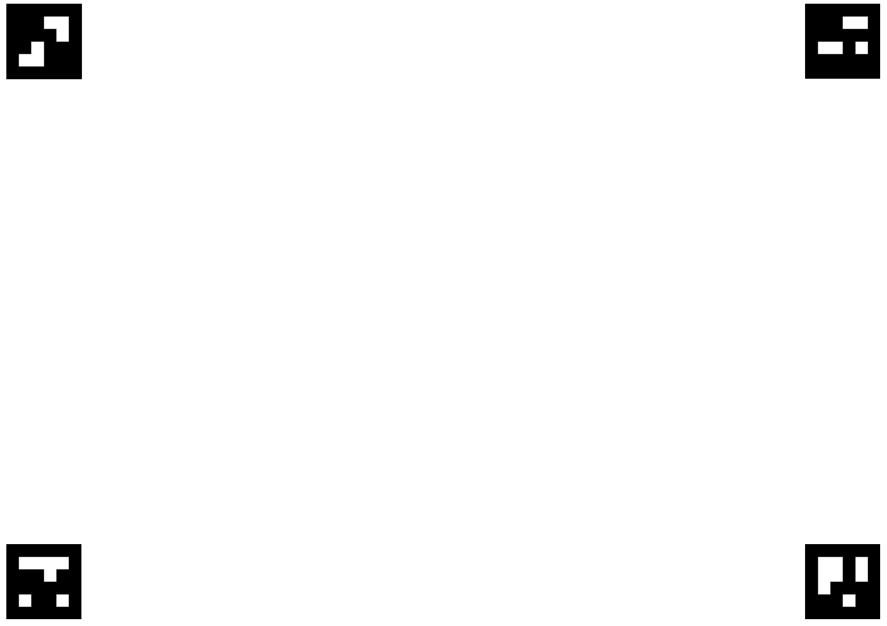

#### Implementation 

The ArUco detection system is initialized in the `Vision` class constructor. This setup creates the detector with the appropriate dictionary and parameters:

```python 
def __init__(self):
    # Initialize ArUco dictionary and detector
    self.aruco_dict = cv2.aruco.getPredefinedDictionary(cv2.aruco.DICT_4X4_100)
    self.param = cv2.aruco.DetectorParameters()
    self.detector = cv2.aruco.ArucoDetector(self.aruco_dict, self.param)
```

The detector is then used throughout the vision pipeline to identify markers in each frame and extract their positions and orientations for coordinate transformations and tracking.

### Bird's-Eye View Transformation

To obtain an accurate occupancy grid, a **bird's-eye view** (top-down perpendicular projection) of the map is required. This transformation corrects perspective distortion using the four corner ArUco markers as reference points. The implementation follows the [OpenCV geometric transformations guide](https://docs.opencv.org/4.x/da/d6e/tutorial_py_geometric_transformations.html).

#### Implementation

The perspective transformation is implemented through two key steps:

1. **Compute the transformation matrix** using `_get_transform_matrix(corners_dict, width_px, height_px)`:
   - Defines source points from the detected corner marker positions in the camera frame.
   - Defines destination points as a perfect rectangle in the output image.
   - Computes the transformation matrix using: [`cv2.getPerspectiveTransform()`](https://docs.opencv.org/4.x/da/d54/group__imgproc__transform.html#ga20f62aa3235d869c9956436c870893ae)

2. **Apply the transformation** using [`cv2.warpPerspective()`](https://docs.opencv.org/4.x/da/d54/group__imgproc__transform.html#gaf73673a7e8e18ec6963e3774e6a94b87):
   - Warps the input frame according to the computed matrix
   - Produces a perfectly perpendicular view of the map

Both operations are performed in the `vision.setup()` method during the initial configuration of the vision system. This setup ensures that all subsequent processing operates on geometrically corrected images, which is essential for accurate obstacle detection and robot localization. 

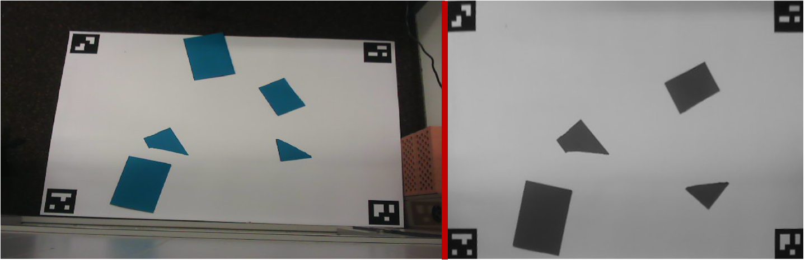 

### Obstacle Mapping

Once the bird's-eye view is obtained, the system generates an **occupancy grid** (cost map) to represent obstacles in the environment. This grid is used by the global navigation module to compute the optimal A* path. The obstacle detection pipeline follows the [OpenCV image processing tutorials](https://docs.opencv.org/4.x/d2/d96/tutorial_py_table_of_contents_imgproc.html) and implements a multi-step approach.

#### Processing Pipeline

**Processing Steps:**

1. **Grayscale conversion** – [`cv2.cvtColor(frame, cv2.COLOR_BGR2GRAY)`](https://docs.opencv.org/3.4/d8/d01/group__imgproc__color__conversions.html) – Simplifies the image for processing.

2. **Gaussian blur** – [`cv2.GaussianBlur(gray, (9, 9), 0)`](https://docs.opencv.org/4.x/d4/d86/group__imgproc__filter.html#gaabe8c836e97159a9193fb0b11ac52cf1) – Reduces noise with a 9×9 kernel.

3. **Adaptive thresholding** – [`cv2.adaptiveThreshold(blurred, 255, cv2.ADAPTIVE_THRESH_GAUSSIAN_C, cv2.THRESH_BINARY_INV, 11, 2)`](https://docs.opencv.org/4.x/d7/d1b/group__imgproc__misc.html#ga72b913f352e4a1b1b397736707afcde3) – Separates obstacles (white) from free space (black) using local intensity thresholds with an 11×11 neighborhood. Adaptive thresholding was chosen over Otsu's method because the controlled lighting conditions provide relatively stable illumination across the map, making the computationally lighter adaptive approach sufficient while maintaining robust obstacle detection.

4. **Corner masking** – Applies black rectangular masks at the four corners to remove ArUco markers that appear as obstacles. Each mask covers the marker area (10 cm) plus a 2 cm margin:
```python
if is_marker_in_corners:
    mask_size_px = int((ARUCO_SIZE_CM + 2.0) * self.pixels_per_cm)
    color = 0  # Black = free space
    h, w = binary.shape
    # Apply masks at all four corners
    cv2.rectangle(binary, (0, 0), (mask_size_px, mask_size_px), color, -1)  # Top-Left
    cv2.rectangle(binary, (w - mask_size_px, 0), (w, mask_size_px), color, -1)  # Top-Right
    cv2.rectangle(binary, (0, h - mask_size_px), (mask_size_px, h), color, -1)  # Bottom-Left
    cv2.rectangle(binary, (w - mask_size_px, h - mask_size_px), (w, h), color, -1)  # Bottom-Right
```

5. **Morphological operations** – [`cv2.morphologyEx(binary, cv2.MORPH_OPEN, kernel)`](https://docs.opencv.org/4.x/d9/d61/tutorial_py_morphological_ops.html) followed by [`cv2.MORPH_CLOSE`](https://docs.opencv.org/4.x/d9/d61/tutorial_py_morphological_ops.html) – Removes small noise with opening, then closes small gaps with closing, using a 3×3 kernel.

6. **Obstacle filling** – [`cv2.findContours(cleaned, cv2.RETR_EXTERNAL, cv2.CHAIN_APPROX_SIMPLE)`](https://docs.opencv.org/4.x/d3/dc0/group__imgproc__shape.html#gadf1ad6a0b82947fa1fe3c3d497f260e0) and [`cv2.drawContours(cleaned, contours, -1, 255, thickness=-1)`](https://docs.opencv.org/4.x/d6/d6e/group__imgproc__draw.html#ga746c0625f1781f1ffc9056259103edbc) – Detects external contours and fills all holes inside obstacles.

7. **Safety margin dilation** – [`cv2.dilate(cleaned, kernel_dilate, iterations=1)`](https://docs.opencv.org/4.x/d4/d86/group__imgproc__filter.html#ga4ff0f3318642c4f469d0e11f242f3b6c) – Expands obstacles by the robot's radius (6.5 cm) using an elliptical structuring element to create a safety buffer.

8. **Distance transform** – [`cv2.distanceTransform(inv_dilated, cv2.DIST_L2, 5)`](https://docs.opencv.org/4.x/d7/d1b/group__imgproc__misc.html#ga8a0b7fdfcb7a13dde018988ba3a43042) – Computes the Euclidean distance from each pixel to the nearest obstacle, creating a gradient cost map with a 7 cm fading zone.

9. **Cost map generation** – [`cv2.max(dilated, fading_border)`](https://docs.opencv.org/4.x/d2/de8/group__core__array.html#gacc40fa15eac0fb83f8ca70b7cc0b588e) – Combines hard obstacles with the distance gradient to produce the final cost map.

10. **Border safety** – [`cv2.rectangle(cost_map, (0, 0), (w-1, h-1), 255, border_thickness)`](https://docs.opencv.org/4.x/d6/d6e/group__imgproc__draw.html#ga07d2f74cadcf8e305e810ce8eed13bc9) – Adds a border around the entire map with thickness equal to the robot's width (13 cm) to prevent edge collisions.

**Visual Pipeline:**

<p align="center">
  
  <br>
  <em>Visual animation of image processing</em>
</p>

| Grayscale | Gaussian Blur | Adaptive Threshold | Corner Mask | Morphological Operations |
|:---------:|:-------------:|:------------------:|:-----------:|:------------------------:|
| 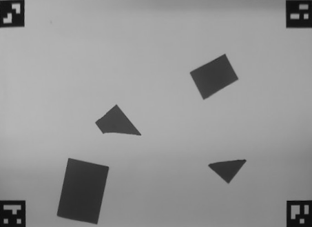 |  | 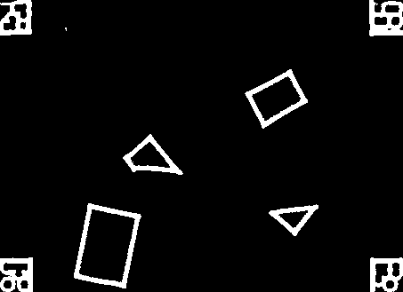 | 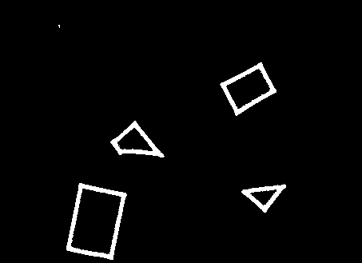 |  |

| Obstacle Filling | Dilation | Fading Gradient | Cost Map | Final Cost Map + Border |
|:----------------:|:--------:|:---------------:|:--------:|:-----------------------:|
| 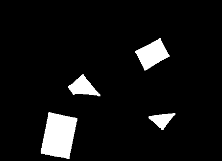 | 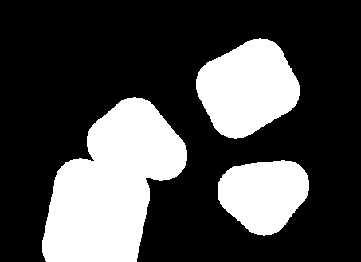 |  | 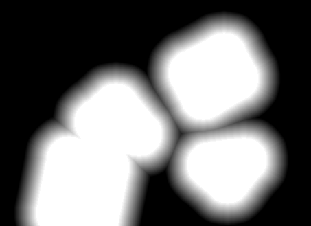 | 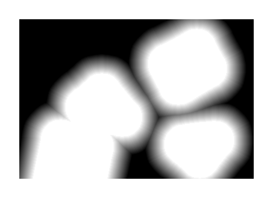 |

#### Implementation

The complete obstacle detection is implemented in the `get_occupancy_grid()` method. This produces a **cost map** where pixel intensity represents traversal cost: 255 (white) indicates hard obstacles, 0 (black) represents free space, and intermediate values (gradient zones) guide the path planner to avoid obstacle edges while maintaining safety margins.

### Frame Capture

To ensure fast and efficient frame acquisition, the camera stream runs in a separate background thread. This design prevents the main control loop from blocking during frame capture operations, which typically take 30-50 ms per frame. Without threading, these delays would introduce timing jitter that could destabilize the control system.

**Thread Architecture:**

The `Camera` class implements a producer-consumer pattern where:
- A **background thread** continuously captures frames from the camera
- The **main thread** consumes the most recent frame on demand

This decoupling ensures the control loop always has access to fresh frames without waiting for I/O operations.

**Key Methods:**

**1. Constructor (`__init__`)** – Initializes the camera and launches the capture thread:

```python
def __init__(self, cam_id=0):
    self.cam_id = cam_id
    self.cap = cv2.VideoCapture(self.cam_id)
    
    if not self.cap.isOpened():
        print(f"Error: Unable to open camera with ID {self.cam_id}")
        self.cap = None
        self.running = False
        return
    
    # Capture initial frame
    self.ret, self.frame = self.cap.read()
    self.running = True
    
    # Launch daemon thread for continuous capture
    threading.Thread(target=self.update, args=(), daemon=True).start()
    print("Camera thread launched")
```

The `daemon=True` flag ensures the thread terminates automatically when the main program exits, preventing orphaned processes.

**2. Update Loop (`update`)** – Runs continuously in the background thread:

```python
def update(self):
    while self.running:
        self.ret, self.frame = self.cap.read()
```

This method constantly refreshes `self.frame` with the latest camera image. The `ret` boolean indicates whether frame capture was successful.

**3. Frame Access (`get_frame`)** – Provides thread-safe access to the latest frame:

```python
def get_frame(self):
    return self.ret, self.frame
```

Returns the most recent frame without blocking. While not explicitly protected by a mutex, this is safe in Python due to the Global Interpreter Lock (GIL), which ensures atomic reference assignments.

**4. Cleanup (`stop`)** – Safely releases camera resources:

```python
def stop(self):
    self.running = False
    if self.cap is not None:
        self.cap.release()
        print(f"Camera with ID {self.cam_id} released, thread stopped")
```

Sets the termination flag and releases the camera device.
This architecture achieves approximately 30 FPS frame access with negligible impact on the main control loop, enabling responsive real-time navigation and localization.

## Filtering

The filtering module implements an **Extended Kalman Filter (EKF)** for robust robot state estimation. The EKF fuses two complementary information sources to maintain accurate pose tracking even when visual measurements are unavailable:

- **Motion model (prediction)**: Uses wheel odometry to propagate the state forward
- **Vision system (update)**: Corrects predictions using ArUco marker detections

This probabilistic approach is essential for handling sensor noise and maintaining localization during marker occlusions.

### Extended Kalman Filter Overview

The robot state is represented as a 3-dimensional vector:

$$\mathbf{x} = \begin{pmatrix} x \\ y \\ \theta \end{pmatrix}$$

where $(x, y)$ is the position in millimeters and $\theta$ is the orientation in radians.

The EKF internally keeps track of two quantities:
- **State estimate** $\mathbf{x}_k$: Best estimate of the robot pose at time $k$
- **Covariance matrix** $\mathbf{P}_k$ (3×3): Uncertainty in the state estimate

**Noise models:**
- **Process noise covariance** $\mathbf{Q}$ (3x3): Models uncertainty of the motion model
- **Measurement noise covariance** $\mathbf{R}$ (3×3): Models camera measurement noise


These matrices were tuned in order to represent the observed noises as well as possible. This approach is detailled in [this notebook](./scripts/filter_tuning.ipynb). As explained in this script we first tested mathematically found covariances which we tuned by hand in a second stage to improve the performance of the filter.

### Prediction Step

The **prediction step** uses the differential drive motion model to propagate the state forward based on wheel speeds. This step is implemented in the `predict()` method. During the prediction step the wheel speeds are assumed to be constant.

**Motion Model Equations:**

Given wheel speeds $v_r$ (right) and $v_l$ (left) over time interval $\Delta t$:

1. **Compute velocities:**

$$v_{\text{lin}} = \frac{v_r + v_l}{2}$$

$$v_{\text{ang}} = \frac{v_r - v_l}{L}$$

where $L = 94$ mm is the wheel base of the robot.

2. **State propagation (non-linear model):**

$$x_{k+1} = x_k + v_{\text{lin}} \cos(\theta_k) \Delta t$$

$$y_{k+1} = y_k + v_{\text{lin}} \sin(\theta_k) \Delta t$$

$$\theta_{k+1} = \theta_k + v_{\text{ang}} \Delta t$$

3. **Covariance propagation (linearized):**

$$\mathbf{P}_{k+1} = \mathbf{F}_x \mathbf{P}_k \mathbf{F}_x^T + Q$$

**Linearized motion model** (computed by `_linearize_motion()` internal method):

$$\mathbf{F}_x = \frac{\partial f}{\partial \mathbf{x}} = \begin{pmatrix} 
1 & 0 & -v_{\text{lin}} \Delta t \sin(\theta) \\ 
0 & 1 & v_{\text{lin}} \Delta t \cos(\theta) \\ 
0 & 0 & 1 
\end{pmatrix}$$

This Jacobian linearizes the non-linear motion model around the current state, enabling the EKF to propagate uncertainty correctly. More information about this choice as well as a seocond option that was considered are explained again in [the kalman tuning notebook](./scripts/filter_tuning.ipynb).

**Implementation detail:**

The model crops the heading to the interval between $[-\pi, \pi]$. This ensures orientation remains within the canonical range, preventing discontinuities.

### Update Step

The **update step** of the filter incorporates absolute pose that we obtain via camera measurements to correct the predicted state. This step is implemented in the `update()` method and follows the standard Kalman filter equations.

**Update Equations:**

1. **Innovation (measurement residual):**

$$\mathbf{y} = \mathbf{z}_k - \mathbf{x}_k$$

where $\mathbf{z}_k$ is the camera measurement and $\mathbf{x}_k$ is the predicted state.

2. **Kalman Gain:**

$$\mathbf{K} = \mathbf{P}_k (\mathbf{P}_k + \mathbf{R})^{-1}$$

The Kalman gain determines the optimal weighting between prediction and measurement:
- If $\mathbf{P}_k$ is large (high prediction uncertainty) → $\mathbf{K} \approx \mathbf{I}$ → trust measurement
- If $\mathbf{R}$ is large (noisy measurement) → $\mathbf{K} \approx 0$ → trust prediction

3. **State correction:**

$$\mathbf{x}_k = \mathbf{x}_k + \mathbf{K} \mathbf{y}$$

4. **Covariance correction:**

$$\mathbf{P}_k = (\mathbf{I} - \mathbf{K}) \mathbf{P}_k$$

The covariance decreases after each measurement, reflecting increased confidence in the state estimate.

**Operational Logic:**

```python
# Main control loop pattern
while robot_running:
    # Always predict (using odometry)
    ekf.predict(right_speed, left_speed, dt)
    
    # Update only when marker is visible
    if marker_detected:
        ekf.update(camera_pose)
    
    # Use filtered state for control
    current_pose = ekf.get_state_cov()
```

During occlusions, the filter continues predicting using only odometry, with uncertainty ($\mathbf{P}$) gradually increasing until the next camera measurement becomes available.

### The filter in action:

The following image shows the filter working during one run of the robot. There are two periods during which the camera was removed (aruco code of the robot gets covered). During this period the covariance of the motion model increases step by step perpendicular to the motion since the robot is more sure about how far it has driven than about if it deviates from its path to the side. The Covariance gets skewed in the curve. When adding the camera, the covariance becomes tiny as soon as the vision is added again and the update corrects the estimation as expected. While the robot is using its vision, the covariance remains static since the vision data represent absolute measurements and the odometry is far less precise than the vision.

<p align="center">
  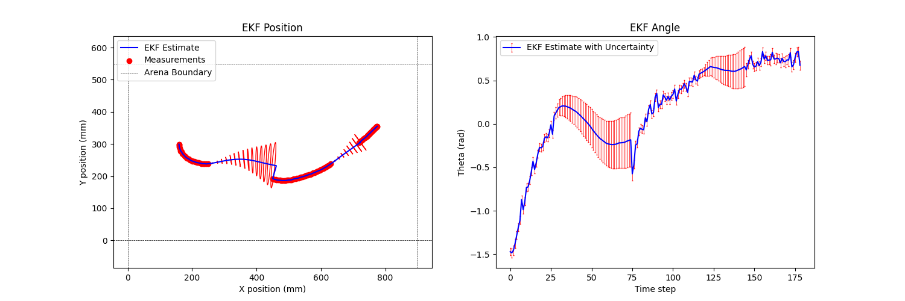
  <br>
  <em>Plot of one run of the EKF</em>
</p>

Here is a video that also illustrates the above explanations:

<p align="center">
    <video width="800" controls>
    <source src="img/elipse_ekf.mp4" type="video/mp4">
    </video>
    <em>Demostration of the EFF in action</em>
</p>

### Coordinate Transformations

The system requires transformations between two reference frames:

**Vision Frame** (camera coordinate system):
- Origin: Top-left corner of image
- Y-axis: Points downward
- Angles: Measured from camera perspective

**EKF Frame** (robot coordinate system):
- Origin: Bottom-left corner of map
- Y-axis: Points upward  
- Angles: Standard mathematical convention

**Transformation Classes:**

**1. CoordinateTransform2D** – Handles spatial coordinate conversions

**2. WheelSpeedTransform** – Converts between Thymio motor units and physical speeds

These transformations are added to the [ekf module](./src/filtering.py) and provide integration between the vision system (providing measurements in pixels), the EKF (operating in millimeters), and the robot controller (commanding in Thymio units).

### References:
The Kalman filter implementation was inspired by the [ROS ekf implementation](https://docs.ros.org/en/lunar/api/robot_localization/html/_downloads/robot_localization_ias13_revised.pdf) as well as the [Kalman filter wikipedia article](https://en.wikipedia.org/wiki/Kalman_filter) for the formulae. The [following article](https://www.alanzucconi.com/2022/07/24/extended-kalman-filter/) has also been helpful. The motion model follows lecture 4 of the Distributed intelligent systems course (ENG-466) taught by A. Martinoli. The slides can be found [here](https://disalw3.epfl.ch/teaching/distributed_intelligent_systems/ay2025-26/lecture/DIS_25-26_W04_lecture.pdf).

## Navigation

The navigation system is divided into two complementary modules: **Global Navigation** for strategic path planning and **Local Navigation** for reactive obstacle avoidance. This architecture follows the hybrid [deliberative-reactive paradigm](https://en.wikipedia.org/wiki/Robotic_paradigm) commonly used in mobile robotics.

### Global Navigation

The global navigation module is responsible for computing the optimal path from the robot's current position to the goal using the cost map provided by the vision system. The implementation is based on the **A-star algorithm**, enhanced with path smoothing and a pure pursuit controller for path following.

The module provides three main functionalities:
1. **Path planning** using A* with 8-connected grid search
2. **Path smoothing** to have a more natural trajectory
3. **Path following** with dynamic target point calculation

#### A* Path Planning

The A* algorithm is implemented in the `grid_search_astar()` method and uses a heuristic-guided search to find the optimal path. The implementation follows standard A* principles with adaptations for grid-based navigation with variable terrain costs.

**Algorithm Overview:**

A* explores the grid by maintaining an **open set** (priority queue) of nodes to evaluate, ordered by their total estimated cost $f(n) = g(n) + h(n)$, where:
- $g(n)$: actual cost from start to node $n$
- $h(n)$: heuristic estimate from node $n$ to goal

**Key Implementation Details:**

1. **Heuristic Function** – The octile distance heuristic is used, this is relevant for the 8-connected grids:
    - The distance is 1 for straight line and $\sqrt{2}$ for diagonal mouvement.

2. **8-Connected Grid Search** – The algorithm explores 8 neighbors (N, S, E, W, NE, NW, SE, SW) with appropriate movement costs:

The total cost incorporates both the movement cost and the terrain cost from the occupancy grid, where gradient zones near obstacles have higher values.

3. **Priority Queue Management** – Python's `heapq` module maintains the open set efficiently.

**Cost Map Integration:**

The cost map values influence path selection:
- **Free space** (value 0): No additional cost
- **Gradient zones** (values 1-254): Increasingly discouraged
- **Obstacles** (value 255): Completely blocked

This creates natural obstacle avoidance behavior, with paths preferring routes through open spaces and away from obstacle edges.
We chose this approach have a cautious "optimal" path. 

#### Path Smoothing

The raw A* path countains only straigh or diagonal mouvement. The `grid_path_smoothing()` method applies a **greedy line-of-sight algorithm** to remove intermediate points while maintaining collision-free paths and giving path with every angle not restraint to 45° mouvement.

#### Greedy line-of-sight algorithm
1. Start with the first point in the A* path as the current point.
2. Iterate through the path points to find the farthest point that can be reached in a straight line from the current point without intersecting any obstacles in the cost map.
3. Add this farthest reachable point to the smoothed path.
4. Update the current point to this farthest reachable point and repeat until the end of the path is reached.

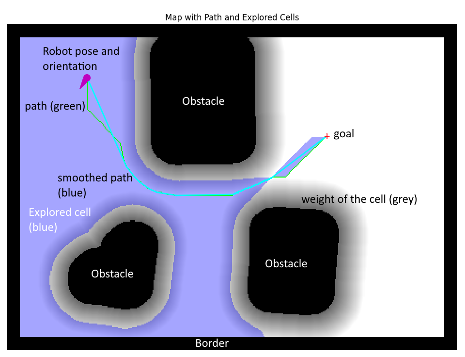

#### Path Following

The path following system uses a **pure pursuit approach** with dynamic lookahead distance, implemented across two key methods: `find_closest_point_smoothed_path()` and `target_point()`.

**1. Closest Point Projection:**

The `find_closest_point_smoothed_path()` method projects the robot's position onto the path by finding the perpendicular projection on each path segment.
If the projected point is outside the segment, we chose the closest extremity.

We define two vectors:
1.  **The Segment Vector ($\mathbf{v}$)**: Representing the direction and magnitude of the path segment.
    $$\mathbf{v} = E - S$$
2.  **The Point Vector ($\mathbf{w}$)**: Representing the vector from the segment start to the robot.
    $$\mathbf{w} = P - S$$

#### 2. Vector Projection
To find the closest point, we first calculate the scalar projection of vector $\mathbf{w}$ onto vector $\mathbf{v}$. This tells us "how far along" the segment the robot is located.
We define a scalar parameter $t$, representing the normalized distance along the segment:

$$t = \frac{\mathbf{w} \cdot \mathbf{v}}{\|\mathbf{v}\|^2}$$

#### 3. Clamping (Handling Finite Segments)
Mathematically, the projection $t$ assumes an infinite line passing through $S$ and $E$. However, our path is composed of finite segments. To constrain the result to the physical segment, we must clamp $t$ to the range $[0, 1]$:

$$t_{clamped} = \max(0, \min(1, t))$$

This logic handles three distinct cases:
* **Case A ($t \leq 0$):** The projection falls "behind" the start point. The closest point is the vertex $S$.
* **Case B ($t \geq 1$):** The projection falls "beyond" the end point. The closest point is the vertex $E$.
* **Case C ($0 < t < 1$):** The projection falls strictly between $S$ and $E$. The closest point is the orthogonal projection on the line.

#### 4. Calculating the Candidate Point
Using the clamped parameter $t_{clamped}$, the coordinates of the closest candidate point $C$ on this specific segment are calculated using linear interpolation:

$$C = S + t_{clamped} \cdot \mathbf{v}$$

#### 5. Minimization
The function iterates through all segments $i$ in the path. For each segment, it calculates the squared Euclidean distance ($d^2$) between the candidate point $C_i$ and the robot $P$:

$$d^2 = \| C_i - P \|^2$$

The function returns the candidate $C_i$ corresponding to the minimum $d^2$.

**2. Target Point Calculation:**

The `target_point()` method advances a specified lookahead distance along the path from the closest point.

It start with the closest point and move along this segment of the path. If the segment length is less than the lookahead distance, it move to the next segment and continue until the lookahead distance is reached.

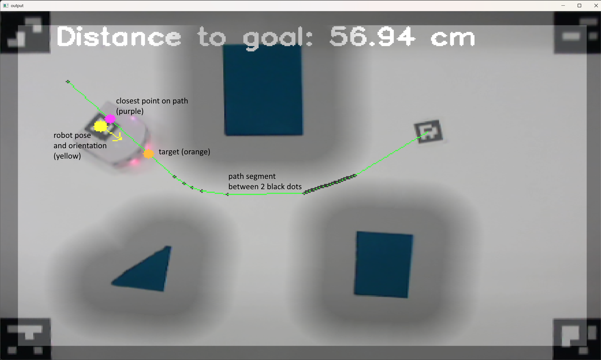

### Local Navigation

#### Map sensor inputs into 2D space

The sensor readings pass through weighted connections to output a 2D repulsion direction.

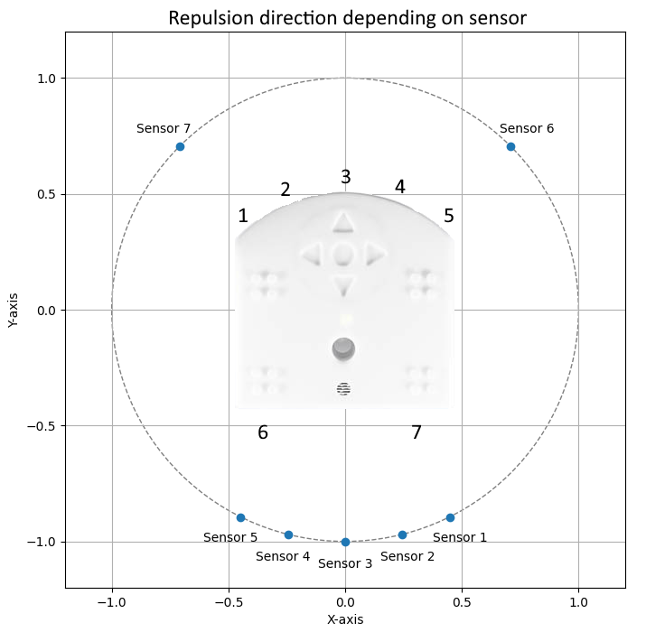

When an obstacle is detected (sensor value >1000), All the sensor are evaluated through their respective weights to compute a repulsion vector.

This repulsion vector is used to know the turning direction to avoid the obstacle.

We turn away from the obstacle and move forward.

Then we turn opposide from the previous turn to put the robot straight and to localize other obstacles.

If no obstacle is detected, the robot recomputes the global path. The obstacle should be on the side the the robot.

This strategy enable obstacle avoidance but has limitations if the obstacle lead the robot closer to the fix obstacles.

<video width="800" controls>
  <source src="img/obs_avoidance_2.mp4" type="video/mp4">
</video>

<video width="800" controls>
  <source src="img/obs_avoidance_3.mp4" type="video/mp4">
</video>

## Motor Command Generation (Astolfi controller)

To translate the high-level navigation commands (target position and desired orientation) into actual wheel velocities, we implement the **Astolfi controller**. This feedback control law is specifically designed for differential drive robots and provides smooth, stable convergence to target poses.

The controller works by defining three error coordinates in the robot's local reference frame:
- **$\rho$**: Distance to the target point
- **$\alpha$**: Heading error (angle between robot orientation and direction to target)
- **$\beta$**: Final orientation error (difference between current and desired final heading)

The control law uses proportional gains ($k_\rho$, $k_\alpha$, $k_\beta$) to compute linear and angular velocities that drive these errors to zero. This ensures the robot not only reaches the target position but also achieves the desired final orientation.

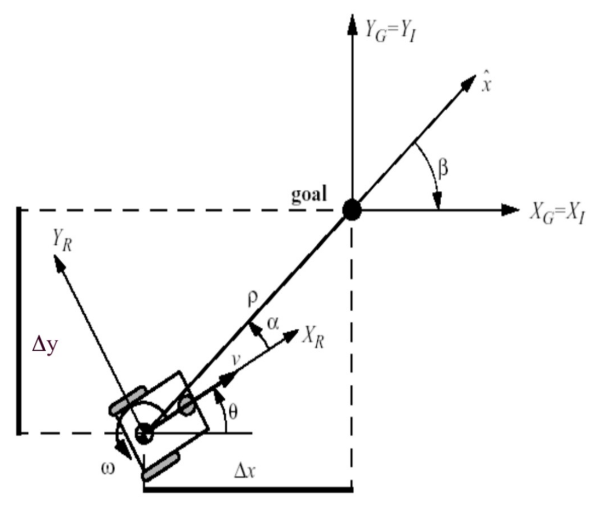

Compute the relevant angles and distances:

$$
\begin{aligned}
\rho &= \sqrt{\Delta x^2 + \Delta y^2} \\
\alpha &= -\theta + \operatorname{atan2}(\Delta y, \Delta x) \\
\beta &= \beta_{desired} -\theta - \alpha
\end{aligned}
$$
We can compute the control law as:
$$
v = k_{\rho} \rho
$$
$$
\omega = k_{\alpha} \alpha + k_{\beta} \beta
$$
And the wheel speeds are given by:
$$
\omega_R = \frac{v}{R} + \frac{L \omega}{R}
$$
$$
\omega_L = \frac{v}{R} - \frac{L \omega}{R}
$$
with $R$ the wheel radius and $L$ half the distance between wheels.

This control law ensures that ($\rho$, $\alpha$, $\beta$) converge to ($0, 0, \beta_{desired}$), meaning the robot reaches the target point with the desired orientation.

### Tuning the gains
We augmented $k_{\rho}$ to have a faster robot speed, before the robot stability decreases.
Same empirical approach was used to tune $k_{\alpha}$ and $k_{\beta}$.
We obtained the following values: 
$k_{\rho} = 1.5$, $k_{\alpha} = 2.2$, $k_{\beta} = -1.0$

## State Machine 
The robot's behavior is orchestrated by a **finite state machine** that coordinates the vision, filtering, and navigation modules. The system operates in five distinct states:

**INIT** – System initialization: launches the camera thread, performs initial ArUco detection to establish the reference frame, computes the bird's-eye view transformation, and generates the occupancy grid.

**LOCALIZE** – Robot localization: continuously scans for the robot's ArUco marker (ID 78) and initializes the EKF state once detected. Transitions to PATH_PLANNING when position is acquired.

**PATH_PLANNING** – Global navigation: detects the goal marker (ID 53), computes the A* optimal path on the cost map, applies path smoothing, and initializes the pure pursuit controller. Moves to FOLLOW_PATH once planning completes.

**FOLLOW_PATH** – Path execution: runs the main control loop combining global navigation (pure pursuit) and local navigation (Braitenberg obstacle avoidance). The EKF continuously fuses odometry and vision measurements. If the robot marker is lost for more than 3 seconds, transitions to KIDNAPPED state.

**KIDNAPPED** – Recovery mode: triggered when prolonged marker occlusion suggests the robot has been moved. Attempts to relocalize the robot marker, and if detected at a significantly different position (>10 cm from prediction), returns to PATH_PLANNING to recompute the path from the new location.

This architecture ensures robust operation with automatic recovery from localization failures and dynamic replanning when the robot's position changes unexpectedly.The image below explain a bit more in details these steps and their transitions.

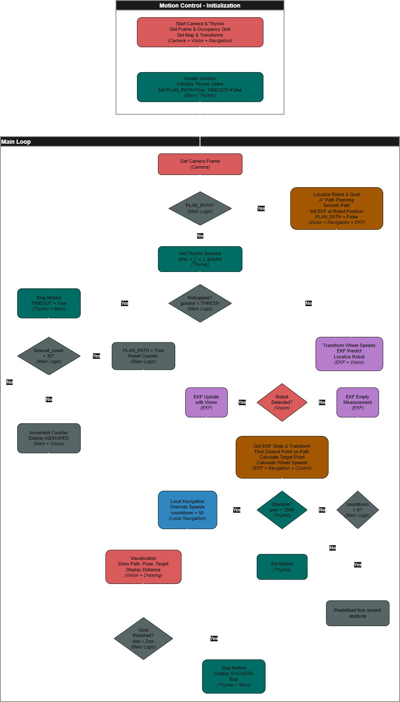